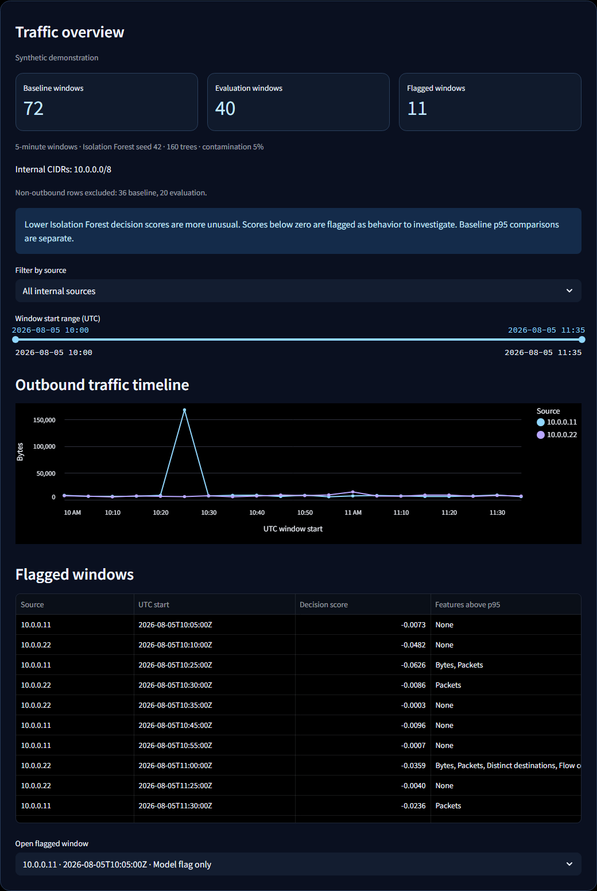
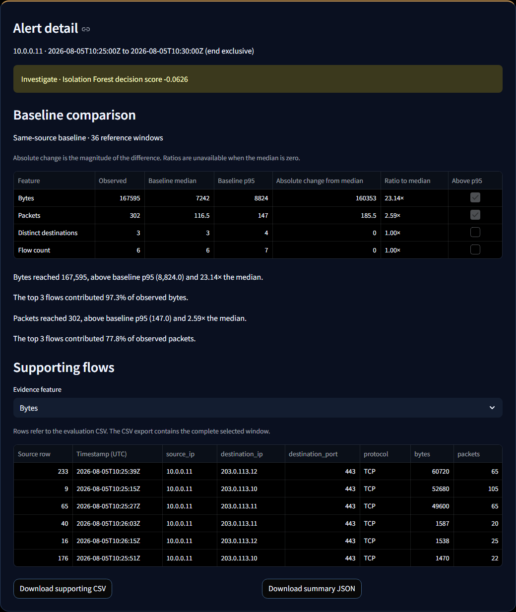
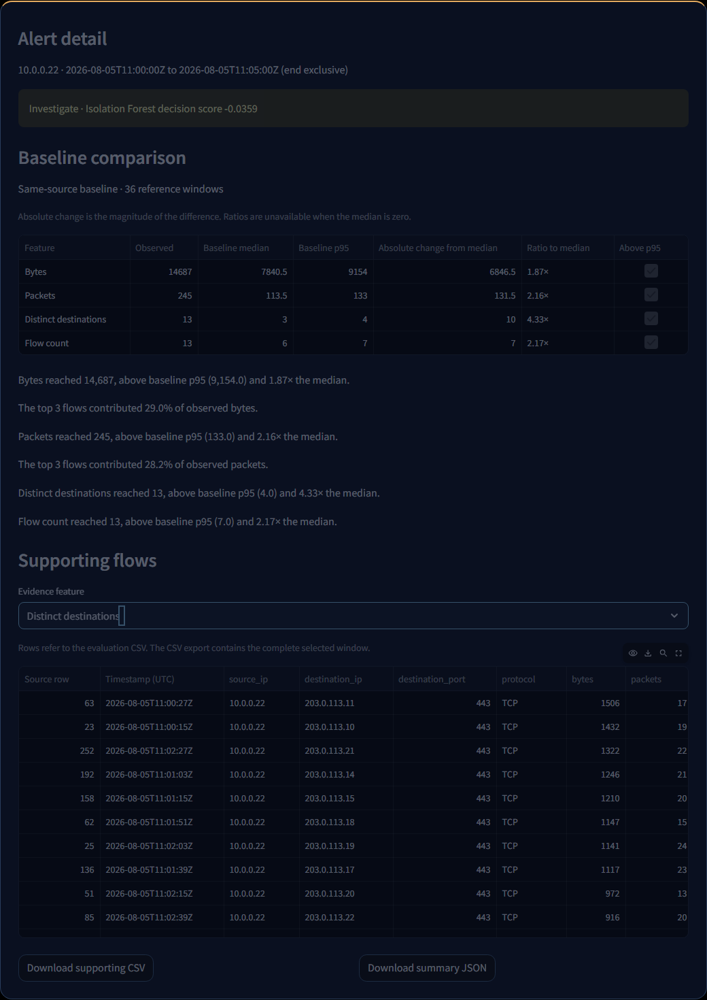

# NetSentinel AI

NetSentinel AI helps an analyst compare outbound network flow windows against an offline baseline and trace alerts to exact CSV records. It reads local flow exports and uses no packet capture, network probes, API keys, or hosted services.

**Author and maintainer** [Prashant Chauhan](https://github.com/itsprshnt20)

**Planned repository** [itsprshnt20/NetSentinel-AI](https://github.com/itsprshnt20/NetSentinel-AI)

## Screenshots

**Midnight-blue traffic overview**



**Byte spike drill-down**



**Destination diversity drill-down**



## Demo recording

[Watch or download the WebM recording](docs/media/netsentinel-demo.webm). It shows the synthetic timeline, byte-spike comparison, source filtering, and destination evidence.


## Features

- Validate independent baseline and evaluation CSVs and report rejected source rows.
- Aggregate outbound flows by source and UTC time window, then score evaluation windows using a baseline-trained Isolation Forest.
- Compare an alert with same-source or fallback baseline statistics, inspect ranked source flows, and export both the evidence and summary.

## Windows setup

Open PowerShell in the project folder with 64-bit Python 3.11 installed.

```powershell
py -3.11 -m venv .venv
.\.venv\Scripts\python.exe -m pip install -r requirements.txt
.\.venv\Scripts\python.exe -m streamlit run app.py
```

Open [the local dashboard](http://127.0.0.1:8501). Dependency installation downloads pinned packages from PyPI. Runtime uses bundled data or local uploads, listens on loopback, and disables Streamlit usage statistics. Files and computed results stay in session memory.

## Two-minute demo

1. Use the defaults of `10.0.0.0/8` and **5 minutes**, then click **Load demo**. The synthetic files produce **72 baseline** and **40 evaluation** outbound windows. The timeline shows per-source bytes.
2. Under **Open flagged window**, choose **10.0.0.11 · 2026-08-05T10:25:00Z**. It contains **167,595 bytes from six flows**. The comparison uses **36 same-source baseline windows**. Open **Evidence feature → Bytes** to see the largest flows first.
3. Download the supporting CSV and summary JSON. CSV rows carry their original evaluation file line numbers and normalized UTC timestamps. JSON includes those row IDs, comparison statistics, and scoring settings.
4. Filter the source to **10.0.0.22** and select **2026-08-05T11:00:00Z**. Choose **Distinct destinations** to inspect the **13 destination addresses** and their matching flows.
5. To exercise the upload path, select both bundled CSVs under **Flow inputs** and click **Analyze uploaded flows**.

## Flow schema

| Column | Accepted values |
| --- | --- |
| `timestamp` | ISO 8601 date and time with seconds, optional fractional seconds, and optional `Z` or `±HH:MM`. Naive timestamps are treated as UTC. Converted UTC years must be 1970–2100. |
| `source_ip`, `destination_ip` | IPv4 or IPv6 literals. Zone identifiers are unsupported. |
| `destination_port` | Integer 0–65,535. Zero can represent a protocol without a destination port. |
| `protocol` | TCP, UDP, ICMP, or ICMPV6, case-insensitive. |
| `bytes`, `packets` | Nonnegative integers up to 10¹² per flow. |

UTF-8 CSVs must have exactly these seven unique headers, in any order. Each file is limited to 3 MiB and 30,000 data records. Row IDs are 1-based physical start lines in the respective input. Malformed values or field counts are rejected with reasons. Unrecoverable CSV quoting or field-length errors stop reading that file at the reported record.

```csv
timestamp,source_ip,destination_ip,destination_port,protocol,bytes,packets
2026-08-05T10:25:15Z,10.0.0.11,203.0.113.10,443,TCP,45000,80
```

## Detection and comparison

- Enter 1–20 CIDR networks, separated by commas or spaces. A flow is outbound if its source belongs to an internal CIDR and its destination belongs to none. The configured CIDRs determine direction. The app reports excluded non-outbound counts.
- Windows are UTC buckets anchored to the Unix epoch. Buckets are start-inclusive and end-exclusive. Empty buckets are omitted. Every window uses total bytes, total packets, distinct destination addresses, and flow count.
- The shared Isolation Forest fits only baseline windows and requires at least 24. It uses seed 42, 160 trees, 5% contamination, and one worker. A negative `decision_function` score is flagged. Lower scores mean more unusual according to the fitted model. The score is not a probability, and a flag calls for investigation.
- The comparison uses at least eight windows of the flagged source when available. Otherwise it uses all shared baseline windows and labels the fallback and count. It shows median, linearly interpolated p95, absolute difference from the median, and observed-to-median ratio. Ratios are unavailable for a zero median. Strictly greater than p95 counts as above p95. Comparison statistics do not set the model flag.
- Evidence is restricted to the selected evaluation source and window. Bytes and packets sort descending by their corresponding counter. Destination evidence lists unique addresses with counts and sorts matching flows by destination. The CSV includes the complete selected window in chronological order, regardless of the evidence sort.

```text
Independent CSVs → Validate UTC rows → Outbound-only windows
                                            |
          Baseline → Fit Isolation Forest and reference statistics
          Evaluation → Score windows → Drill down → CSV + JSON
```

## Tests and reproduction

```powershell
.\.venv\Scripts\python.exe -m unittest discover -s tests -v
.\.venv\Scripts\python.exe samples\generate_flows.py
```

The generator recreates the two synthetic fixtures. The unit suite checks the resulting windows, scores, reference counts, and exact exports. For the optional browser check, start the app in a second terminal. Playwright downloads its Chromium headless shell and supporting tools.

```powershell
.\.venv\Scripts\python.exe -m pip install playwright==1.65.2
.\.venv\Scripts\python.exe -m playwright install chromium --only-shell
.\.venv\Scripts\python.exe tests/browser_smoke.py
```

## Limitations

- The demo is synthetic. It provides no detection-accuracy estimate for production traffic. Baseline drift, shared hosts, and legitimate bulk transfers can all affect scores.
- The model uses aggregated outbound counters. It does not inspect payloads, identify services or users, infer causation, or actively investigate destinations.
- No-traffic periods are omitted. Sparse or short traces may lack enough baseline windows. The reference may fall back to traffic from other internal sources.
- Exported evidence can contain private addresses from user data. Review the selected window before sharing it.

## GitHub handoff

**Repository description** Passive network flow anomaly detection with baseline comparisons, supporting flow evidence, and exportable findings.

**Resume bullet** Built a local Streamlit flow-analysis dashboard with baseline-only Isolation Forest scoring, per-source comparisons, and row-traceable evidence exports.

For a new empty repository, run these commands from the project folder after local authentication. If the target already has commits, clone and inspect it before adding the audited source.

```powershell
git init -b main
git add -- .gitattributes .gitignore .streamlit LICENSE README.md app.py flows.py requirements.txt requirements.lock.txt docs/screenshots docs/media samples/generate_flows.py samples/synthetic_baseline.csv samples/synthetic_evaluation.csv tests
git diff --cached --check
git commit -m "Build NetSentinel AI passive flow dashboard"
git remote add origin https://github.com/itsprshnt20/NetSentinel-AI.git
git push -u origin main
```

## License

Original source and synthetic fixtures are under the [MIT License](LICENSE). Dependencies are installed separately under their upstream licenses. The archive contains no dependency packages.
